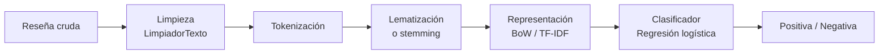

# Procesamiento de lenguaje natural: limpieza de texto y análisis de sentimientos

Dos trabajos del curso de **Procesamiento de Lenguaje Natural (NLP)** de la Universidad Pontificia Bolivariana:

1. **Práctica de limpieza de texto con pandas:** 18 ejercicios resueltos de normalización y extracción sobre texto real "sucio".
2. **Trabajo final, análisis de sentimientos:** un pipeline completo para clasificar reseñas de cine de FilmAffinity como positivas o negativas. Va de la limpieza del texto a la representación numérica y el entrenamiento de un clasificador.

> Autor: **Sebastián Muñoz Palacio** · Docente: [José R. Zapata](https://joserzapata.github.io)

**Stack:** Python 3.12 · pandas · scikit-learn · regex · uv · Jupyter

---

## 1. Práctica de limpieza de texto

Notebook: [`notebooks/Practica_Limpieza_Texto.ipynb`](notebooks/Practica_Limpieza_Texto.ipynb)

Usa los métodos de `pandas.Series.str` y expresiones regulares sobre cuatro conjuntos de datos (texto general, tweets, productos y personas):

| Tema | Ejercicios |
|---|---|
| Normalización | Minúsculas, espacios, puntuación, acentos y emojis |
| Extracción | Emails, URLs, hashtags, menciones y retuits |
| Datos de negocio | Tallas de productos, precios en distintos formatos (`$1.234,50`, `USD 45`, `30,00 €`) y filtros por texto |
| Datos de personas | Nombres propios, respuestas categóricas (sí/no), ciudad desde la dirección y validación de IDs (`ABC-0001`) |
| Pipeline | Función `limpia_basica()` que encadena todo, medición de cuánto cambió el texto y guardado en Parquet |

## 2. Trabajo final: análisis de sentimientos en reseñas de cine

Notebook: [`notebooks/NLP-trabajo-final.ipynb`](notebooks/NLP-trabajo-final.ipynb)

### Datos

- **Fuente:** reseñas de FilmAffinity en español (`author_review_desc` y `author_rating` de 1 a 10).
- **Muestra:** 50,000 reseñas, sin valores nulos.
- **Variable objetivo:** `sentiment_bin` = 1 (positiva) si la calificación es mayor que 6; 0 (negativa) en otro caso.
- **Partición:** 80 % entrenamiento y 20 % prueba, estratificada para conservar la proporción de clases.

### Pipeline



| Etapa | Implementación |
|---|---|
| **Limpieza** | Clase `LimpiadorTexto`: minúsculas; eliminación de URLs, emails, menciones, hashtags, números y caracteres especiales; corrección de abreviaturas comunes; espacios y palabras repetidas |
| **Tokenización y normalización** | Clases propias `Tokenizador`, `StemmerEspanol` y `LematizadorEspanol` |
| **Representación** | Clase `RepresentadorTexto` con *Bag of Words* y TF-IDF, con `fit` sobre entrenamiento y `transform` sobre prueba para evitar fuga de información |
| **Modelo** | Regresión logística, con opción de comparar Random Forest, Gradient Boosting, SVM, árbol de decisión y KNN |
| **Evaluación** | Accuracy, precision, recall, F1, ROC AUC y reporte de clasificación |

Los representadores y el modelo entrenado quedan serializados (`representador_*.pkl`, `modelo_final.pkl`), de modo que un texto nuevo pase exactamente por las mismas transformaciones.

---

## Estructura del repositorio

El proyecto parte de la plantilla de ciencia de datos del curso (Python 3.12, `uv`, devcontainer, pre-commit y CI con GitHub Actions).

| Ruta | Contenido |
|---|---|
| [`notebooks/`](notebooks/) | Los dos notebooks del trabajo y los artefactos serializados (`.pkl`) |
| [`pyproject.toml`](pyproject.toml) | Dependencias del proyecto |
| `src/`, `tests/`, `conf/`, `data/` | Estructura base de la plantilla |

## Cómo ejecutarlo

```bash
uv sync
uv run jupyter lab
```

Abre los notebooks en `notebooks/`. El trabajo final descarga el dataset de reseñas directamente desde la URL indicada en el notebook.
